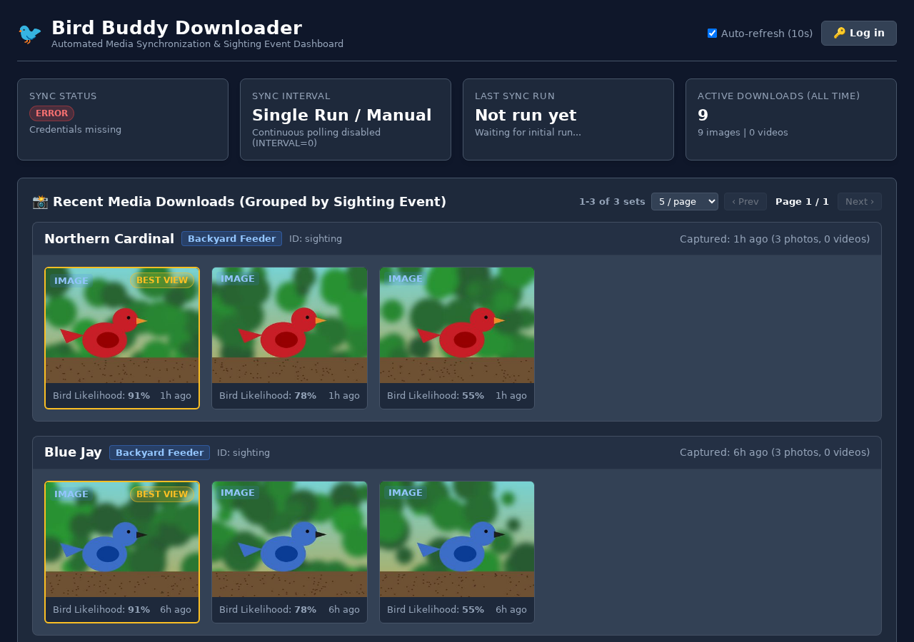
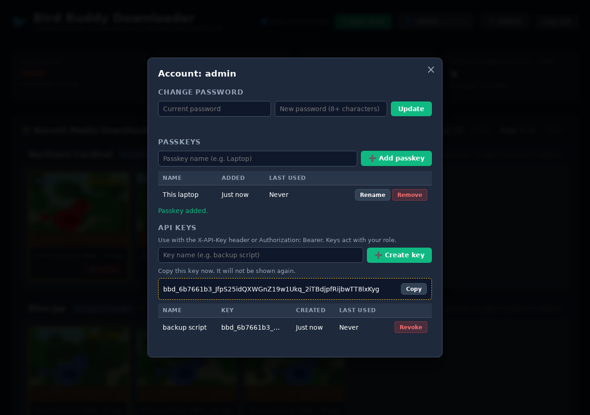

# Bird Buddy Automatic Media Downloader

An automated python utility to download images and videos from all Bird Buddy cameras attached to your account.

## Features

- **Multi-Camera Support**: Downloads media from all Bird Buddy cameras associated with your account automatically.
- **Detection & Visit Grouping Placeholders**:
  - Group all photos and videos captured during a single visitor detection event into dedicated folders or filenames using `{detection_id}`, `{detection_id_short}`, `{postcard_id}`, or `{sighting_id}`.
- **Efficient Incremental Sync (`--buffer-hours`)**:
  - Uses the timestamp of the latest downloaded media item in the database as the starting point.
  - Goes back 2 hours prior to the latest detection timestamp (`--buffer-hours 2`) to ensure no missed events, then halts feed pagination automatically.
  - Can be overridden using `--full-sync` to force a complete re-scan.
- **Automatic Database Cleanup (`--db-retention-days`)**:
  - Automatically purges database records older than 14 days (`--db-retention-days 14`) after each run to keep tracking compact.
- **Customizable Output Directory & Filename Templating**:
  - Customize subdirectories (`--dir-template`) and filenames (`--filename-template`).
  - Supports placeholders for feeder name, species, owner name, date, time, year, month, day, media ID, detection ID, media type, extension, and more.
  - Maintains default structure (`{feeder_name}/{species_name}/{year}{month}{day}_{hour}{minute}{second}_{media_id_short}.{ext}`) if unconfigured.
- **Feeder & Account Reporting (`--info`)**:
  - Displays real-time feeder statistics: battery level, charging status, food level, Wi-Fi signal strength, temperature, and camera state.
  - Breakdown of available images and videos per bird species.
  - Earliest and latest event capture timestamps recorded for each camera feeder.
  - Output as formatted text or machine-readable JSON (`--json`).
- **Dry-Run Mode (`--dry-run`)**:
  - Preview media items that would be downloaded vs skipped without performing disk writes or database mutations.
- **De-duplication**: Tracks downloaded media in a local SQLite database (`birdbuddy_downloader.db`). Never downloads the same image or video twice.
- **Timestamp Preservation**:
  - Sets the file modification time (`mtime` / `atime`) on all images and videos to match the capture timestamp from Bird Buddy metadata.
  - Embeds EXIF metadata (`DateTime`, `DateTimeOriginal`, `DateTimeDigitized`) into JPEG image files, written in the local timezone with the matching `OffsetTime*` tags so photo libraries such as Immich show the correct local capture time. Set `TZ` (e.g. `TZ=America/New_York`) to the feeder's timezone. When `TZ` is unset, native runs use the system timezone and containers use UTC.
  - Only newly downloaded photos get local times and offset tags. Photos downloaded before this change keep the UTC wall time they were written with, and are not rewritten.
- **XMP Sidecars**: Writes a `<file>.xmp` sidecar next to every photo and video, read by Immich, digiKam, darktable and Lightroom. It holds:
  - the capture time (local timezone with offset), which also covers videos, since EXIF only goes into JPEGs;
  - a caption such as `House Finch at Bird Buddy feeder "Backyard" (Springfield, United States), 2026-10-14 08:46 EDT.`;
  - the feeder's city and country (`photoshop:City` / `photoshop:Country`);
  - hierarchical tags `Bird Buddy/Species/<name>`, `Bird Buddy/Feeder/<name>` and `Bird Buddy/City/<city>` (`digiKam:TagsList`, `lr:hierarchicalSubject` and flat `dc:subject` keywords);
  - the Bird Buddy media ID and sighting ID (`bbd:MediaID`, `bbd:SightingID`).

  Unlike the database, this metadata stays with the file after `--db-retention-days` prunes old records. Sidecars move with their media on delete and restore. Files that were already downloaded get a sidecar the next time a sync sees them (use `--full-sync` to backfill everything). Disable with `--no-xmp` / `NO_XMP=true`. Bird Buddy only reports a city name, so the sidecar has no GPS coordinates.
- **Flexible Execution**:
  - **Single-run mode**: Ideal for running via `cron` or `systemd` timers.
  - **Continuous daemon mode**: Polls periodically on a schedule (`--interval 3600`).
- **Web Status Dashboard & Sighting Gallery**:
  - Embedded real-time web dashboard running on port `8080` (configurable via `--web-port` / `WEB_PORT`).
  - **Sighting-Based Grouping**: Media is grouped by `sighting_id` detection events over the past week (with synchronized pagination controls at the top right and bottom right of the section).
  - **Automated Bird Detection & Likelihood Scoring**: Evaluates image bird presence and confidence via OpenCV DNN using a bundled YOLO26-L object detection model on letterboxed images. See [Bird Detection Model Selection](#bird-detection-model-selection).
  - **"Best View" Highlighting**: Automatically tags and highlights the image with the highest bird detection likelihood ($\ge \text{--min-bird-confidence}$, default `0.25`) within each sighting group with a **"Best View"** badge and gold border. If all scored images fall below the confidence threshold, no image is highlighted; when detection scores are not available, the first eligible image in the group is selected.
  - **Interactive Lightbox Modal**: View full-size images or video clips directly by clicking thumbnails, including bird likelihood percentages.
  - **User Accounts & Passkeys**: Guests can browse; deleting, restoring, syncing and changing settings require login. Supports `user`/`admin` roles, passkeys (WebAuthn), per-user API keys, and an admin settings page. See [Web Dashboard Authentication](#web-dashboard-authentication).
  - **Soft Delete & Temporary Trash Storage**: Move unwanted files to a `.trash/` directory directly from the UI with a `🗑️ Delete` button. Deleted files remain visible with a `[Removed]` badge and can be reverted with `↩️ Restore`.
  - **Automated Trash Purging**: Files in `.trash/` are permanently removed from disk when their database record ages out (`--db-retention-days 14`), while active downloads are preserved.
  - Displays sync interval, last sync execution time/status, next scheduled sync countdown, and connected feeder hardware status.
  - Shows breakdown table of photos and videos downloaded over the **past hour**, **past day (24 hours)**, and **past week (7 days)** per camera feeder and overall totals.
  - Provides a "Sync Now" button to trigger immediate on-demand syncing.
- **Session Resilience & Anti-Throttling**:
  - Automatically preserves and refreshes OAuth tokens across runs, preventing excessive password authentication that causes account/IP throttling.
- **Robust Sockets & Timeouts**:
  - Granular connection (`15s`) and socket read (`30s`) timeouts prevent network stalls from hanging the daemon.
- **Media Filtering**: Option to skip videos (`--no-videos`), skip images (`--no-images`), or filter by specific feeder name (`--feeder-filter`).

---

## Setup & Installation

### 1. Clone or Open the Repository
```bash
cd /path/to/birdbuddy-downloader
```

### 2. Set Up Virtual Environment
Create and activate a Python virtual environment:
```bash
python3 -m venv venv
source venv/bin/activate
```

### 3. Install Dependencies
Install all required packages from `requirements.txt`:
```bash
pip install -r requirements.txt
```

### 4. (Optional) Provision Bird Detection Model
When running locally outside of the container, export or place the YOLO26-L ONNX model in `models/yolo26l.onnx`:
```bash
# Export yolo26l.onnx using ultralytics (one-time setup, ~100 MB)
python -m pip install ultralytics
python -c "from ultralytics import YOLO; YOLO('yolo26l.pt').export(format='onnx', imgsz=640, opset=12, end2end=False)"
mkdir -p models && mv yolo26l.onnx models/yolo26l.onnx
```
If `models/yolo26l.onnx` is missing, the downloader falls back to `models/yolo26n.onnx` or `models/yolov8n.onnx`, which are faster but find far fewer birds (see below).
*Note: In container deployments, the model is automatically bundled during the build. If running locally without a model, you can provide a custom path via `--model-path` / `BIRD_MODEL_PATH` or disable detection using `--no-detect`.*

### 5. Configure Credentials & Options
Edit the `.env` file with your Bird Buddy account email and password (and optional configuration):
```env
USERNAME="your_email@example.com"
PASSWORD="your_password"

# Optional settings
# BUFFER_HOURS=2.0
# DB_RETENTION_DAYS=14
# MIN_BIRD_CONFIDENCE=0.25
# BIRD_MODEL_PATH="models/yolo26l.onnx"
# DIR_TEMPLATE="{feeder_name}/{species_name}/{date}_{detection_id_short}"
# FILENAME_TEMPLATE="{detection_id_short}_{id_short}.{ext}"
```

---

## Container Deployment (Podman / Docker)

You can run `birdbuddy-downloader` in a container using **Podman** or **Docker**.

### 1. Configure `.env`
Ensure your `.env` file contains your credentials and desired options:
```env
USERNAME="your_email@example.com"
PASSWORD="your_password"
INTERVAL=3600  # Set to >0 for continuous polling mode in container
TZ="America/New_York"  # Feeder timezone for EXIF capture times (default: UTC)
```

### 2. Run with `podman-compose` or `docker compose`
Build and launch the container in background mode:
```bash
# Using podman-compose
podman-compose up -d --build

# Using docker compose
docker compose up -d --build
```

### 3. Run single commands or dry-runs via container
```bash
# Build image manually
podman build -t birdbuddy-downloader -f Containerfile .

# Run dry-run via container
podman run --rm --env-file .env \
  -v ./downloads:/app/downloads:z \
  -v ./data:/app/data:z \
  birdbuddy-downloader --dry-run
```

### 4. Automated Container Builds (GitHub Actions)

A GitHub Actions workflow is provided at [`.github/workflows/docker-publish.yml`](.github/workflows/docker-publish.yml) to automatically build multi-arch container images (`linux/amd64` and `linux/arm64`) and publish them to Docker Hub:
- **Pull Requests**: Tagged with `:pr-<branch_name>` and `:pr-<pr_number>` for pull requests originating from source branches within this repository only when the latest PR commit has a `stage` git tag (never built or published for forks).
- **`release` Tag**: Pushing the git tag `release` on a commit that is on `main` publishes `:latest` and a date-based build version `:YYYYMMDDNN`: the UTC date plus a two-digit build number for that day, starting at `01`, e.g. `:2026102901`. A matching `YYYYMMDDNN` git tag is created for each release. This is the only way `:latest` or a version tag is published. If `release` points at a commit that isn't on `main`, the workflow fails and publishes nothing. `release` is a moving tag, so force-push it:
  ```bash
  git fetch origin && git tag -f release origin/main && git push -f origin release
  ```
- **`main` Branch**: Merging or pushing to `main` builds nothing. Use the `dev` tag to test `main`, and the `release` tag to publish it.
- **`dev` Tag**: Pushing the git tag `dev` builds that commit and publishes it as `:dev` only, for testing before a release. It never gets `:latest` or a version tag. `dev` is a moving tag, so force-push it to move it to the current `main`:
  ```bash
  git fetch origin && git tag -f dev origin/main && git push -f origin dev
  ```
- **Manual Runs** (*Run workflow* in the Actions tab): Run on the `release` or `dev` tag, it does the same as pushing that tag; on `release` that means a new `YYYYMMDDNN` release. Run on anything else, it publishes `:sha-<short_sha>` only.

**Required GitHub Repository Secrets**:
- `DOCKERHUB_USERNAME`: Your Docker Hub username (e.g. `moosemouse`).
- `DOCKERHUB_TOKEN`: Docker Hub Personal Access Token (PAT) with Read/Write permissions.

---

## Bird Detection Model Selection

The bird score comes from a COCO-trained YOLO object detector (class 14, `bird`) run through OpenCV DNN on the CPU. The default is **YOLO26-L with letterboxed input**, chosen from the test below.

### How it was tested

- **Photos:** 150 photos picked at random from one week of real Bird Buddy captures at two feeders: 101 from a side-view window feeder, 49 from a top-down platform feeder. All are 1944×2592 portrait JPEGs straight from Bird Buddy.
- **Labels:** each photo was checked by eye. All 150 contain a bird. 34 were marked *hard*: the bird is very close and cut off, seen from behind, motion-blurred, dark, or washed out by lens flare. The other 116 are *clear*.
- **Measure:** a photo counts as *found* when its bird score reaches 0.25, the default `--min-bird-confidence`.
- **Preprocessing:**
  - *Stretch* resizes the photo straight to 640×640, squashing it. This is what the downloader did before.
  - *Letterbox* scales the long side to 640 and pads the rest with gray, keeping the aspect ratio. This matches how the YOLO models were trained.
- **Hardware and timing:** an idle Intel Core i7-6820HQ (4 cores / 8 threads) running OpenCV 4.10. OpenCV 5.0 gives identical scores. Each time covers JPEG decoding, preprocessing and the model, per photo, using all 8 threads.
- **Export:** every model was exported with `imgsz=640, opset=12, end2end=False`.

### Results

| Model | ONNX size | Found, stretch | Found, letterbox | Score ≥ 0.50, letterbox | Clear photos found (letterbox) | Hard photos found (letterbox) | ms per photo |
| :--- | ---: | ---: | ---: | ---: | ---: | ---: | ---: |
| yolov8n | 13 MB | 25% | 34% | 20% | 40% | 15% | 94 |
| yolo11n | 11 MB | 43% | 53% | 39% | 62% | 21% | 100 |
| yolo26n *(previous default)* | 10 MB | **31%** | 37% | 21% | 42% | 18% | 104 |
| yolov8s | 45 MB | 45% | 51% | 38% | 59% | 24% | 187 |
| yolo11s | 38 MB | 50% | 67% | 57% | 78% | 32% | 199 |
| yolo26s | 38 MB | 49% | 47% | 33% | 57% | 15% | 203 |
| yolov8m | 104 MB | 70% | 75% | 65% | 87% | 32% | 383 |
| yolo11m | 81 MB | 65% | 69% | 60% | 81% | 26% | 474 |
| yolo26m | 82 MB | 77% | 77% | 65% | 91% | 29% | 479 |
| **yolo26l** *(default)* | 100 MB | 81% | **90%** | **76%** | **99%** | **59%** | 592 |

The ms column is the median of the stretch and letterbox runs, which never differed by more than 6 ms. Times were steady: p90 stayed within 3 ms of the median.

Results by camera angle (found, at the 0.25 threshold):

| | Side-view feeder (101) | Top-down feeder (49) |
| :--- | ---: | ---: |
| yolo26n, stretch *(previous)* | 31% | 33% |
| yolo11s, letterbox | 72% | 57% |
| yolo26l, letterbox *(default)* | 97% | 76% |

### What the results show

- **Model size matters most.** COCO's `bird` class is mostly birds seen at a distance. Close-up feeder shots look very different, so the nano and small models usually aren't confident anything is there. When they do guess, they pick classes such as `bench` (the perch), `cake` (the seed tray) or `elephant`.
- **Letterboxing is free and usually helps.** It raised the score on more than half the photos for all 10 models, and never added time. Stretching is also misleading on a single photo: one clear close-up of a tufted titmouse scored 0.32 with the previous setup and 0.93 with YOLO26-L and letterboxing.
- **The cost is size, not speed.** At about 0.6 s per photo, the two test feeders (~120 photos a day between them) need around a minute of CPU a day. The model file grows from 10 MB to 100 MB, and the container image grows with it.
- **If you need a smaller model,** use `yolo11s` with `--model-path`: 38 MB, about 0.2 s per photo, 67% found.

### Caveats and upgrading

- Every test photo contained a bird, so false positives on empty frames weren't measured. If a larger model scores empty frames too high, raise `--min-bird-confidence`.
- Scores already stored in the database came from the previous model and aren't recalculated. Only newly downloaded photos get new scores, so the "Best View" badge on older sightings won't change.

---

## Directory & Filename Templating

You can define custom directory structures and filenames using `--dir-template` and `--filename-template` flags (or `DIR_TEMPLATE` and `FILENAME_TEMPLATE` in `.env`).

### Available Template Variables

| Variable | Description | Example |
| :--- | :--- | :--- |
| `{feeder_name}` or `{feeder}` | Name of the camera feeder | `Back Porch` |
| `{feeder_id}` | Unique ID of the feeder | `516e45ea-449c-4da2-88b0...` |
| `{species_name}` or `{species}` | Detected bird/animal species | `Northern Cardinal` |
| `{owner_name}` or `{owner}` | Owner of the feeder camera | `moosemaus` |
| `{detection_id}` or `{postcard_id}` | Unique ID grouping all media from a single visit/postcard detection | `86394c2e-97a0-49e1-bbac...` |
| `{detection_id_short}` or `{postcard_id_short}` | First 8 characters of detection/postcard ID | `86394c2e` |
| `{sighting_id}` | Sighting report ID | `e9d4437e-6c52-48ae-b896...` |
| `{sighting_id_short}` | First 8 characters of sighting report ID | `e9d4437e` |
| `{year}` or `{YYYY}` | 4-digit capture year | `2026` |
| `{year_short}` or `{YY}` | 2-digit capture year | `26` |
| `{month}` or `{MM}` | 2-digit capture month | `07` |
| `{day}` or `{DD}` | 2-digit capture day | `21` |
| `{hour}` or `{HH}` | 2-digit capture hour (24-hour) | `18` |
| `{minute}` or `{min}` or `{mm}` | 2-digit capture minute | `29` |
| `{second}` or `{sec}` or `{SS}` | 2-digit capture second | `44` |
| `{date}` | Compact date (`YYYYMMDD`) | `20260721` |
| `{iso_date}` | ISO formatted date (`YYYY-MM-DD`) | `2026-07-21` |
| `{time}` | Compact time (`HHMMSS`) | `182944` |
| `{iso_time}` | ISO formatted time (`HH-MM-SS`) | `18-29-44` |
| `{media_id}` or `{id}` | Full unique media UUID | `16223fa7-7cfc-4543...` |
| `{media_id_short}` or `{id_short}` | First 8 characters of media UUID | `16223fa7` |
| `{media_type}` or `{type}` | Media type (`image` or `video`) | `image` |
| `{ext}` or `{extension}` | File extension (`jpg` or `mp4`) | `jpg` |

---

## Grouping Media by Detection Event

Because a single bird visit/detection generates multiple photos and 1 video, you can group them into a subfolder per detection using `{detection_id_short}` or `{postcard_id_short}`:

```bash
./venv/bin/python3 downloader.py \
  --dir-template="{feeder_name}/{species_name}/{date}_{detection_id_short}" \
  --filename-template="{detection_id_short}_{id_short}.{ext}"
```

**Resulting Structure**:
```text
downloads/Back Porch/Tufted Titmouse/20260721_86394c2e/
├── 86394c2e_16223fa7.jpg
├── 86394c2e_36fd43ed.jpg
└── 86394c2e_3c68fcd6.mp4
```

---

## Usage & Commands

### Display Feeder Information & Species Breakdown
To view camera battery levels, food status, signal strength, earliest/latest event timestamps, and species counts:
```bash
./venv/bin/python3 downloader.py --info
```

### Dry-Run Mode
To see what files would be downloaded without saving files or modifying the database:
```bash
./venv/bin/python3 downloader.py --dry-run
```

### Force Full Sync
To bypass the 2-hour buffer incremental cutoff and scan all feed pages:
```bash
./venv/bin/python3 downloader.py --full-sync
```

### Run Media Sync Once (Default)
To scan for and download all new images and videos from all cameras:
```bash
./venv/bin/python3 downloader.py
```

### Command Line Options

```text
usage: downloader.py [-h] [--env-file ENV_FILE] [--username USERNAME]
                     [--password PASSWORD] [--download-dir DOWNLOAD_DIR]
                     [--db-path DB_PATH] [--dir-template DIR_TEMPLATE]
                     [--filename-template FILENAME_TEMPLATE]
                     [--buffer-hours BUFFER_HOURS]
                     [--db-retention-days DB_RETENTION_DAYS] [--full-sync]
                     [--interval INTERVAL] [--max-pages MAX_PAGES]
                     [--no-images] [--no-videos]
                     [--feeder-filter FEEDER_FILTER] [--dry-run] [--info]
                     [--json] [--web-port WEB_PORT] [--web-host WEB_HOST]
                     [--web-public-url WEB_PUBLIC_URL]
                     [--reset-password USERNAME] [--no-web]
                     [--min-bird-confidence MIN_BIRD_CONFIDENCE]
                     [--model-path MODEL_PATH] [--no-detect] [--no-xmp] [-v]

Automatic Bird Buddy media downloader with de-duplication, metadata timestamping, web dashboard, and feeder info.

options:
  -h, --help            show this help message and exit
  --env-file ENV_FILE   Path to .env file containing credentials (default: .env)
  --username USERNAME   Bird Buddy account email (overrides USERNAME env var)
  --password PASSWORD   Bird Buddy account password (overrides PASSWORD env var)
  --download-dir DOWNLOAD_DIR
                        Directory to save downloaded media (default: ./downloads or DOWNLOAD_DIR env var)
  --db-path DB_PATH     SQLite DB path for de-duplication (default: ./data/birdbuddy_downloader.db or DB_PATH env var)
  --dir-template DIR_TEMPLATE
                        Template for output subdirectories relative to download-dir (default: '{feeder_name}/{species_name}').
  --filename-template FILENAME_TEMPLATE
                        Template for output filenames (default: '{year}{month}{day}_{hour}{minute}{second}_{media_id_short}.{ext}').
  --buffer-hours BUFFER_HOURS
                        Hours before latest downloaded detection to start fetching feed items (default: 2.0 or BUFFER_HOURS env var)
  --db-retention-days DB_RETENTION_DAYS
                        Days to retain records in database before cleanup (default: 14 or DB_RETENTION_DAYS env var; set to 0 to disable)
  --full-sync           Bypass latest detection cutoff and perform a full feed sync
  --interval INTERVAL   Interval in seconds for continuous polling mode (0 for single run or INTERVAL env var)
  --max-pages MAX_PAGES Maximum feed pages to fetch (0 for unlimited or MAX_PAGES env var)
  --no-images           Skip downloading image files
  --no-videos           Skip downloading video files
  --feeder-filter FEEDER_FILTER
                        Filter downloads by feeder name (case-insensitive substring)
  --dry-run             Perform a dry run without downloading files or modifying database
  --info                Display feeder information, battery status, species media counts, and event date ranges
  --json                Output --info as raw JSON
  --web-port WEB_PORT   Port for embedded web status dashboard (default: 8080 or WEB_PORT env var)
  --web-host WEB_HOST   Host address to bind embedded web dashboard (default: 0.0.0.0 or WEB_HOST env var)
  --web-public-url WEB_PUBLIC_URL
                        Public HTTPS URL of the dashboard, e.g. https://birds.example.com (or WEB_PUBLIC_URL env var). Required for passkey login; also marks session cookies Secure
  --reset-password USERNAME
                        Reset the web dashboard password for USERNAME and exit. In an interactive terminal you are prompted for the new password; otherwise a single-use random password is generated and printed
  --no-web              Disable embedded web status dashboard
  --min-bird-confidence MIN_BIRD_CONFIDENCE
                        Minimum detection confidence threshold to count as a bird match (default: 0.25 or MIN_BIRD_CONFIDENCE env var)
  --model-path MODEL_PATH
                        Path to ONNX object detection model for bird identification (default: models/yolo26l.onnx or BIRD_MODEL_PATH env var)
  --no-detect           Skip bird detection likelihood scoring on downloaded images
  --no-xmp              Do not write <file>.xmp metadata sidecars next to downloaded media (or NO_XMP env var)
  -v, --verbose         Enable debug logging
```

---

## Web Dashboard Authentication

Anyone who can reach the dashboard can **view** status, sightings, photos and videos. Anything that changes state requires logging in.

| Action | Guest | `user` | `admin` |
| :--- | :---: | :---: | :---: |
| View dashboard, sightings & media | ✅ | ✅ | ✅ |
| Delete / restore media, Sync Now | | ✅ | ✅ |
| Change own password, manage own passkeys & API keys | | ✅ | ✅ |
| Add / delete users, set roles, reset passwords | | | ✅ |
| Edit runtime settings (interval, templates, filters, detection) | | | ✅ |

| Guest (read-only) | Admin account menu: passkeys & API keys |
| :---: | :---: |
|  |  |

More screenshots of each flow are in [`docs/screenshots/`](docs/screenshots/).

### First login

On the first start with an empty user table, an `admin` account is created with a random password, which is printed once in the logs:

```text
[WARNING] No users found - created initial web dashboard administrator:
[WARNING]     username: admin
[WARNING]     password: 3qT...
```

With containers, use `podman logs birdbuddy-downloader` (or `docker logs ...`). Log in with **🔑 Log in**.

This password is **single-use**: after logging in you must choose a new password before you can do anything else, so the value left in the logs stops working. The same applies to any password you didn't choose yourself: ones generated or set by an admin, or generated by `--reset-password`. API keys are separate credentials and keep working while a password change is pending.

### Passkeys

Passkeys (WebAuthn) only work in a secure context and need a fixed hostname. Put the dashboard behind an HTTPS reverse proxy and set its public address:

```bash
WEB_PUBLIC_URL="https://birds.example.com"
```

When `WEB_PUBLIC_URL` is set, logged-in users can add passkeys from **👤 Account** and sign in with **Sign in with a passkey**. When it is not set, password login still works and passkey options are hidden. For local testing, `http://localhost:8080` also counts as a secure context.

### API keys

Each user can create personal API keys from **👤 Account**. A key acts with its owner's role and is shown only once:

```bash
curl -X POST -H "X-API-Key: bbd_xxxxxxxx_..." http://localhost:8080/api/sync
curl -X POST -H "Authorization: Bearer bbd_xxxxxxxx_..." \
     -H "Content-Type: application/json" -d '{"media_id": "..."}' \
     http://localhost:8080/api/media/delete
```

> The shared `WEB_API_KEY` / `--web-api-key` option has been removed. If it is still set, a warning is logged and it is ignored. Create a personal API key instead.

### Settings page

Admins can edit runtime settings from **🛠️ Admin → Settings**. Saved values take effect immediately, are stored in the database, and override command-line/environment values on later starts. **Reset** returns a setting to its command-line/environment value. Bird Buddy credentials, paths and web host/port can only be set through the environment or CLI.

### Locked out?

Reset any user's password from the command line (this also signs out their sessions). In an interactive terminal you are prompted for the new password, and nothing is printed:

```bash
./venv/bin/python3 downloader.py --reset-password admin
podman exec -it birdbuddy-downloader python downloader.py --reset-password admin
```

Without a terminal (no `-it`, or in a script), a random **single-use** password is generated and printed instead. It must be changed at the next login.

---

## Regular Automated Execution

### Option A: Running as a Background Daemon (`--interval`)
You can run the downloader continuously in the background to poll every hour (3600 seconds):
```bash
./venv/bin/python3 downloader.py --interval 3600
```

### Option B: Cron Job (Every Hour)
Open your crontab:
```bash
crontab -e
```
Add the following entry to check for new media every hour:
```cron
0 * * * * cd /home/rmonk/repos/birdbuddy-downloader && ./venv/bin/python3 downloader.py >> downloader.log 2>&1
```

### Option C: Systemd Service & Timer (Linux)

1. Create a service file `/etc/systemd/system/birdbuddy-downloader.service`:
```ini
[Unit]
Description=Bird Buddy Media Downloader
After=network.target

[Service]
Type=oneshot
WorkingDirectory=/home/rmonk/repos/birdbuddy-downloader
ExecStart=/home/rmonk/repos/birdbuddy-downloader/venv/bin/python3 /home/rmonk/repos/birdbuddy-downloader/downloader.py

[Install]
WantedBy=multi-user.target
```

2. Create a timer file `/etc/systemd/system/birdbuddy-downloader.timer`:
```ini
[Unit]
Description=Run Bird Buddy Downloader hourly

[Timer]
OnCalendar=hourly
Persistent=true

[Install]
WantedBy=timers.target
```

3. Enable and start the timer:
```bash
sudo systemctl daemon-reload
sudo systemctl enable --now birdbuddy-downloader.timer
```

---

## License

This project is licensed under the [MIT License](LICENSE).
